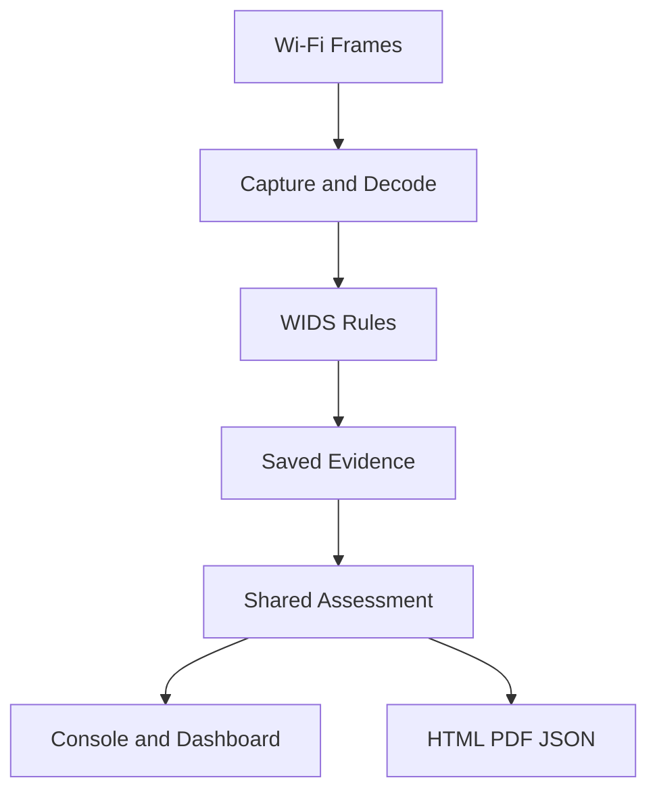

# GET THE HACKER

**Walk. Scan. Detect. Understand.**

GTH is a passive Wi-Fi WIDS by **Aliaksandr Zasinets**.
It checks received frames for attack signs. It saves Evidence.
License: **GPL-2.0-only**.

## What does it detect?

GTH checks Deauth bursts, AP policy changes, and Evil Twin signs.
It also checks Recon, KARMA signs, EAPOL attempts, and repeated rejects.
Normal Probe Requests and unknown APs are not attacks.
A MAC address does not identify a person.



## Install

Needs Python 3.11+, SQLite support, and Bash.
Linux or Termux also needs `iw` and `ip`.
Scapy 2.6.1 is bundled. No pip install is needed for basic use.
Raw capture needs root, a supported driver, and Monitor Mode.

After a copy, set the script mode:

```sh
chmod +x gth.sh install.sh
```

Run `bash install.sh` once to add the `gth.sh` command.
It uses your user bin folder. It installs no packages.

## Run

```sh
./gth.sh
```

No flags are needed. Ctrl+C stops Capture and saves reports.
A disconnected wlan2 can enter Monitor Mode if the driver supports it.
Changed radio state is restored at exit.
A connected adapter is not switched automatically.
Managed wlan0 gives local link status. It gives no packet WIDS.
GTH checks the current channel. It does not hop channels.
GPS is optional. Capture works without a GPS fix.

## Read the result

| Result | Meaning |
|---|---|
| DETECTED | Saved Evidence matched an attack indicator rule |
| NOT DETECTED | No sign matched the checked rules and frames |
| NOT ASSESSED | The check has no complete result |

Use 1 to 4 for Networks, Checks, Events, and Help.
Use arrows, Enter, and Esc for details.
Open the local Dashboard URL shown in Help.
The AP diagram is a schematic. It is not a location map.

Linux saves new sessions in `reports/` in this app.
Android saves results in `/sdcard/Download/GTH/`.
Reports and logs are created at runtime. They are not source files.

## Offline commands

```sh
./gth.sh demo
./gth.sh replay /path/to/capture.pcap
./gth.sh report /path/to/session
python3 tools/verify_proofs.py /path/to/session
```

Demo generates synthetic frames in memory. It sends no radio frames.
Replay needs raw Wi-Fi PCAP, PCAPNG, or normalized JSONL input.
Keep session logs and Proof files together for verification.

Read [Installation](docs/INSTALL.md), [Android](docs/ANDROID.md),
[Architecture](docs/ARCHITECTURE.md), [Detection](docs/DETECTION.md),
[Reports](docs/REPORTING.md), and [Limits](docs/LIMITATIONS.md).
See [Third-party code](THIRD_PARTY.md) for bundled source licenses.
