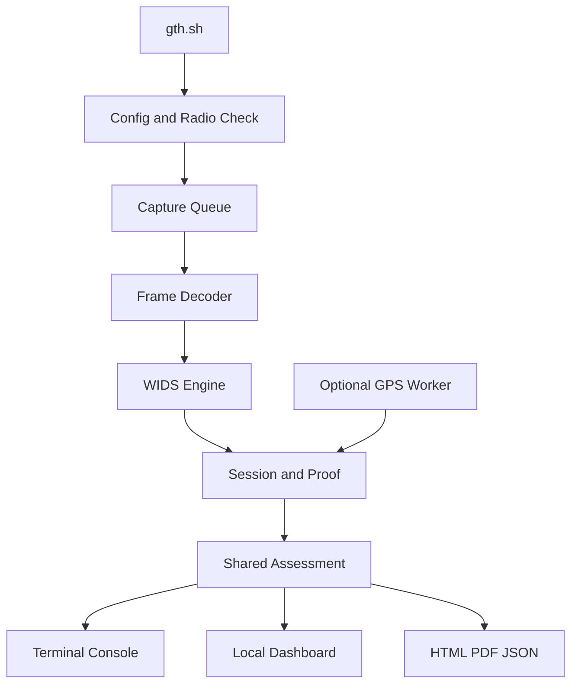

# Architecture

| Component | Code |
|---|---|
| Start and restore | gth/auto.py and gth/radio.py |
| Capture and rules | gth/packets.py and gth/engine.py |
| Assessment | gth/assessment.py and gth/security.py |
| Evidence | gth/runtime.py and gth/proof.py |
| AP history | gth/networks.py and private SQLite cache |
| Console | gth/console.py and gth/presentation.py |
| Web and reports | gth/web.py, gth/report_page.py, and web/ |
| GPS and ranges | gth/gps.py and gth/positioning.py |
| Public advice and Demo | config/advice.json and gth/demo.py |

The callback fills a bounded queue. It does not write reports.
One report worker writes periodic HTML and JSON.
Final export reads all saved telemetry.
The active AP cache has 1024 rows. Full AP history stays separate.
A private temporary SQLite file keeps that history during Capture.
Final AP history is exported to the session folder.
A screen limit does not delete raw Evidence.
A missing GPS fix or terminal error does not stop Capture.
The local web server binds to 127.0.0.1.
All visible security results use the shared Assessment.
